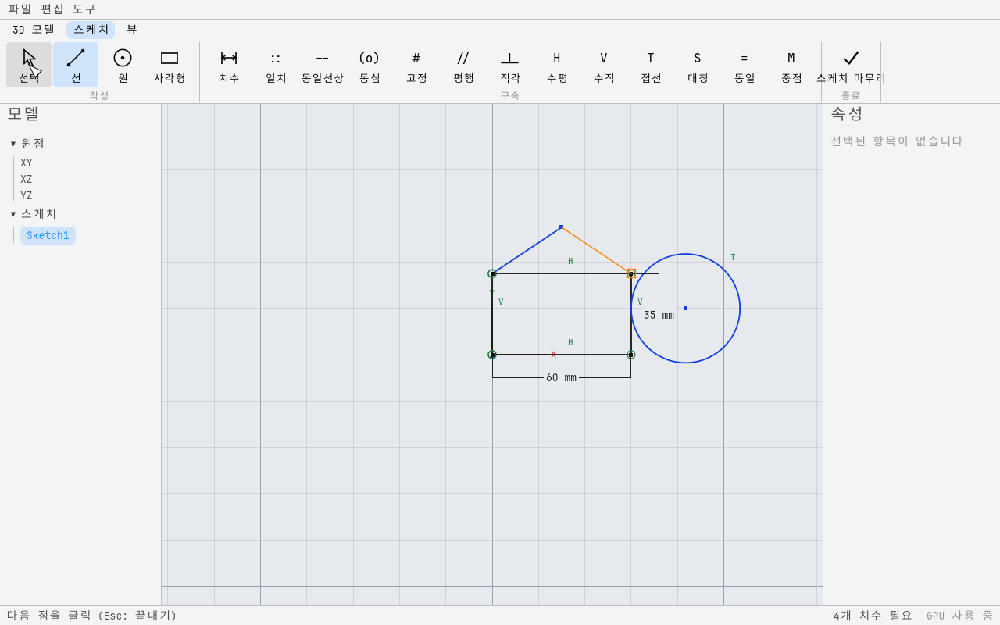

# Stage 4 증거 — UI 체크포인트 (셸 + 2D 스케치)

## 화면

`crates/app/gc_app/tests/shell.rs::shell_renders_with_gpu`가 앱 전체를 오프스크린으로 렌더한 결과(1280×800, SwiftShader).
테스트는 리본의 "XY 스케치" 버튼을 실제로 누른 뒤 세션에 도구 입력을 넣어 그린다.

확인한 것:
- 메뉴(파일·편집·도구), 리본 탭(3D 모델·스케치·뷰), 스케치 탭의 작성(선택·선·원·사각형) / 구속(치수 + 구속 12종) / 종료 그룹.
- 왼쪽 모델 브라우저(원점 XY·XZ·YZ, 스케치 목록), 오른쪽 속성 패널, 아래 상태바(도구 안내, 남은 치수 수, GPU 상태).
- 원점에 붙인 사각형은 폭 60 mm·높이 35 mm 치수로 완전 구속되어 검정, 원과 선은 아직 움직일 수 있어 파랑.
- 구속 글리프(H, V, T, 일치 동그라미), 치수선과 치수 문자, 그리기 중인 선의 주황 미리보기와 끝점 스냅 표시.
- 그리드와 X/Y 축.

## 테스트

| 항목 | 결과 |
|---|---|
| `cargo xtask gate` | 통과 (fmt, check, clippy, Windows 교차 clippy, 테스트, GPU 테스트, 레이어, 라이선스) |
| GPU 없이 실행 (`shell_runs_without_gpu`) | 통과: 리본 클릭으로 스케치 시작 → 도구 전환 → 그리기 → 스케치 마무리 |
| 헤드리스 시나리오 S1–S6 (`gc_session/tests/scenarios.rs`) | 9개 통과 |

## 아직 없는 것 (다음 작업)

- ViewCube, GPU 선 파이프라인, 메시 파일(STL/OBJ) 표시.
- 파라미터 표, 호·트림 도구, 3D 스케치 UI.
- 치수 더블클릭 편집(지금은 치수를 선택하고 속성 패널의 수식 칸에서 고친다).

## 로봇 셀 화면 (2026-11-17)

`cargo xtask test-gpu`의 `robot_cell_renders_with_gpu`가 리본만으로 셀을 만든 뒤 렌더한 결과다
(샘플 6축 로봇 추가 → 조그 → "현재 자세" 웨이포인트 → 상자 장애물 → 경로 만들기 → 계획).

| 파일 | 보여야 할 것 | 확인 |
|---|---|---|
| `img/review-5-robot-path.png` | 로봇(어두운 링크/주황 링크 교대), 기둥, 초록 TCP 궤적, 자홍 웨이포인트 P1, 그리드는 솔리드 아래. 오른쪽에 조그 슬라이더 6개, 바디 배치, 플래너 선택·시드·"계획됨"·예상 시간·최소 여유·상태 검사 수·시간 슬라이더. 브라우저에 바디/로봇/웨이포인트/경로 | 확인함 |
| `img/review-6-playback.png` | 같은 장면에서 재생 시간 절반: 로봇이 기둥을 넘어가는 중간 자세, 조그 값이 그 자세를 표시 | 확인함 |

솔리드는 GPU 메시 렌더러(인스턴싱, reverse-Z)로 그리고, 궤적·웨이포인트·스케치는 egui 페인터로 그 위에 그린다.
궤적 선은 GPU 선 파이프라인으로 그려 솔리드 뒤에서는 가려진다(같은 날 추가). 스케치·웨이포인트 표식·TCP 좌표축은 편집을 위해 계속 맨 위에 그린다.

## UR5e (2026-11-17)

`ur5e_cell_renders_with_gpu`: 리본의 "UR5e 로봇"으로 추가한 UR5e(내장 플러그인이 레지스트리로 제공한 URDF + 충돌 STL 7개)로
기둥을 돌아가는 경로를 계획하고 렌더한다. 드로 호출 8회(링크 메시 7 + 기둥), 삼각형 7천 개 이상임을 단언한다.

| 파일 | 보여야 할 것 | 확인 |
|---|---|---|
| `img/review-7-ur5e-path.png` | UR5e 메시(링크별 색 교대), 기둥, TCP 궤적, P1, 조그 슬라이더에 UR 조인트 이름 | 확인함 |
| `img/review-8-ur5e-playback.png` | 재생 절반 시점: 팔이 기둥 옆을 지나는 자세 | 확인함 |

UR5e 메시 배치는 `gc_plugin_ur/tests/ur.rs`가 수치로 검증한다(팔을 수직으로 세웠을 때 모든 메시 정점이 베이스 축 주변의
좁은 기둥 안에 있고, 바닥이 z = 0, 꼭대기가 툴 바로 위).

## UR5e 실제 외형 (2026-11-17)

UR5e를 제조사 시각 메시(`meshes/ur5e/visual/*.dae`, BSD-3-Clause, 12만 삼각형)로 그린다. 파일의 재질 색 4가지(링크 밝은 회색,
관절 진회색, 검정 실, 파란 캡)를 그대로 쓴다. 충돌 검사는 계속 단순한 충돌 STL로 한다.

| 파일 | 보여야 할 것 | 확인 |
|---|---|---|
| `img/review-9-ur5e-close-up.png` | 실제 UR5e 외형: 회색 튜브, 진회색 관절, 파란 캡. "전체 보기"가 로봇을 화면에 꽉 맞춤 | 확인함 |
| `img/review-7-ur5e-path.png`, `img/review-8-ur5e-playback.png` | 같은 외형으로 기둥을 피하는 경로와 재생 중간 자세 | 확인함 |

`gc_plugin_ur/tests/ur.rs`가 시각 메시도 수치로 검증한다(팔을 세웠을 때 모든 정점이 베이스 축 주변 기둥 안, 파트 20개,
재질 색 4가지). 읽는 데 약 30 ms.

## 3D 스케치 (2026-11-17)

| 파일 | 보여야 할 것 | 확인 |
|---|---|---|
| `img/review-10-3d-sketch.png` | 원점에서 X로 150 mm, 위로 200 mm, 그다음 공간으로 나가는 3D 폴리라인. 길이·높이 치수 라벨, 작업 평면 그리드(YZ), 상태바의 "작업 평면 YZ (Tab으로 전환)"과 "3개 치수 필요", 리본의 3D 구속(X/Y/Z 방향, XY/YZ/ZX 평면 위) | 확인함 |

`a_3d_sketch_is_drawn_in_the_viewport`가 실제 마우스 이벤트로 첫 점 배치(작업 평면 위), 고무줄 표시, Tab 평면 전환, Esc를 확인한다.
아직 없는 것: 3D에서 점 드래그, 치수 더블클릭 편집(속성 패널에서는 수정 가능), 구속 글리프.

## 스케치한 선을 따라가는 UR5e (2026-11-17)

`the_ur5e_follows_a_sketched_polyline`: 3D 스케치에 L자 폴리라인(첫 선에 300 mm 치수) → "스케치 경로" → "계획".
경로는 P1까지 자유 이동, P2·P3까지 직선 이동(LIN)이다. 테스트는 TCP가 세 스케치 점을 10 mm 이내로 지나고 선 위에서는 높이를
1 mm 이내로 유지하는지, 치수를 200 mm로 바꾸면 경로가 "오래됨"이 되고 다시 계획하면 옮겨진 모서리를 지나는지 확인한다.

| 파일 | 보여야 할 것 | 확인 |
|---|---|---|
| `img/review-11-ur5e-follows-sketch.png` | UR5e의 툴이 스케치 선 위(P2 근처)에 있고, 초록 궤적이 P1까지는 곡선, P1→P2→P3은 직선. 패널에 웨이포인트별 "직선(LIN)" 체크 | 확인함 |

## 작업 좌표계 기준 웨이포인트 (2026-11-17)

`waypoints_follow_a_work_frame`: XY 스케치에 점 하나 → 아직 자유로울 때 "좌표계"는 거부되고 상태바가 이유를 말함 → 원점에서
X 500 mm, Y 200 mm 치수로 완전 구속 → "좌표계"로 Frame1 생성 → UR5e를 두 자세로 조그하며 "좌표계 기준"으로 P1, P2를
Frame1 기준으로 저장 → 경로 계획 → X 치수를 600 mm로 바꾸면 P1, P2가 정확히 +100 mm 이동하고 경로가 "오래됨" → 다시 계획하면
옮겨진 P2에서 끝남.

| 파일 | 보여야 할 것 | 확인 |
|---|---|---|
| `img/review-12-work-frame.png` | 바닥의 Frame1 좌표축(이름 표시), 그 기준의 P1·P2와 계획된 궤적, 브라우저의 "좌표계" 항목, 패널의 "좌표계 기준 위치"(기준 좌표계 선택, 좌표계 회전, P1/P2 오프셋) | 확인함 |

