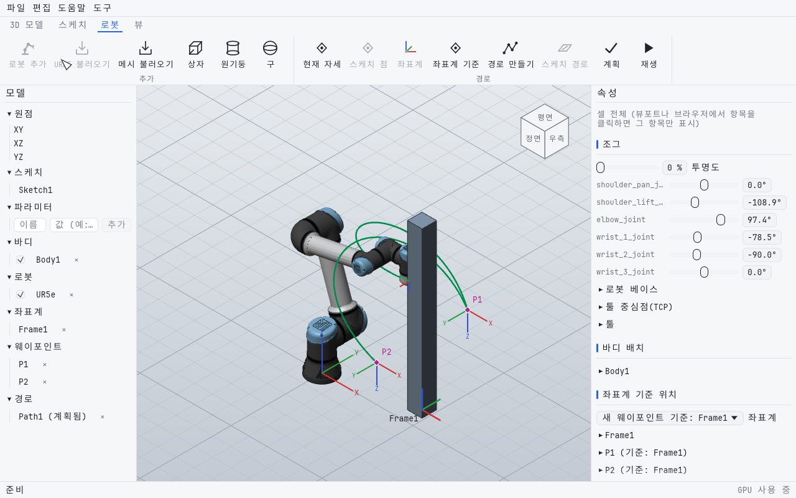
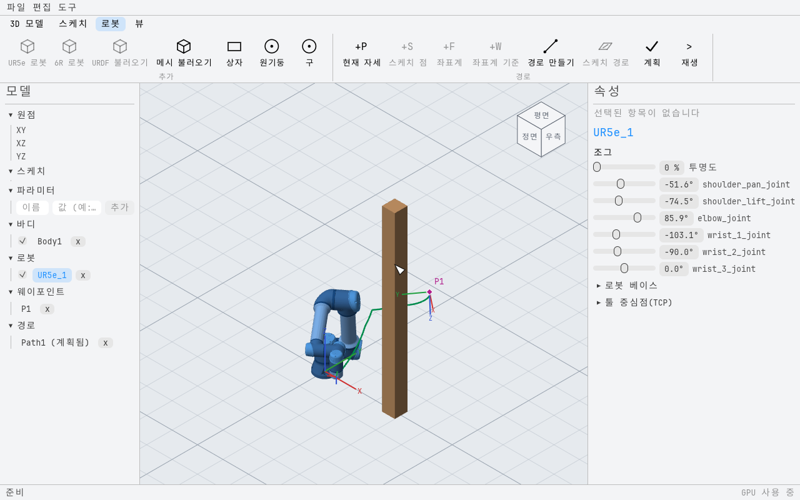
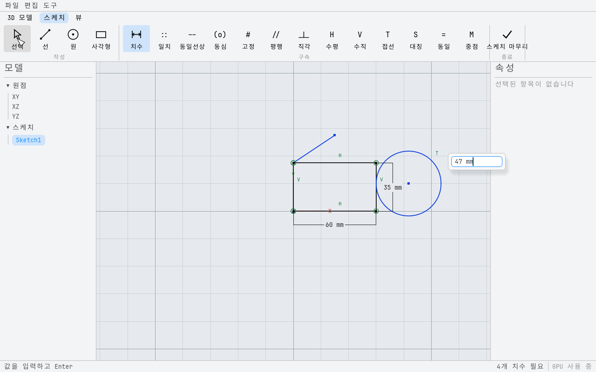
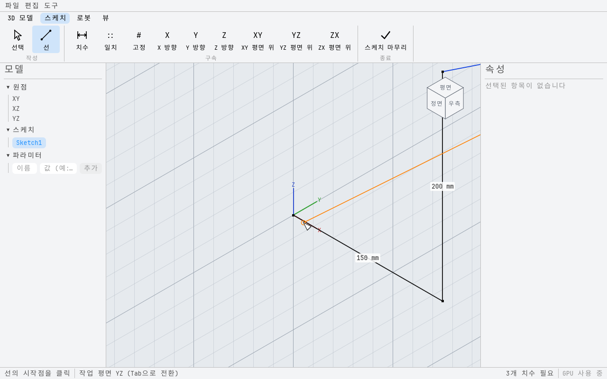
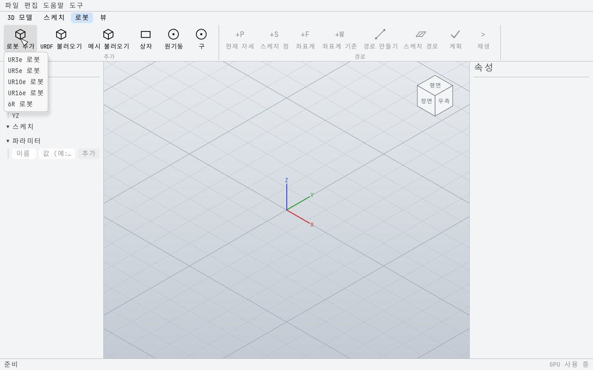
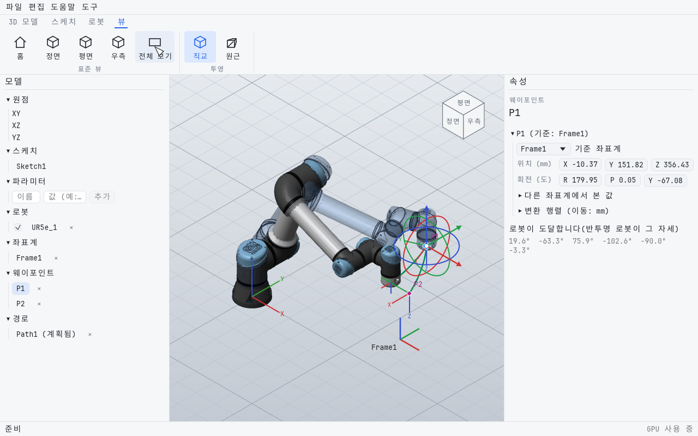
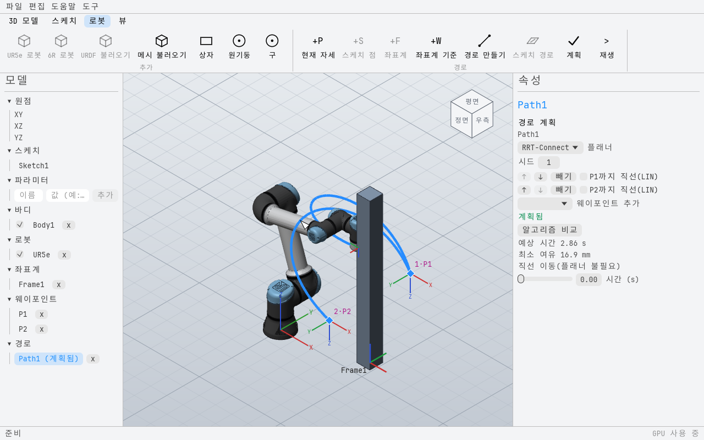
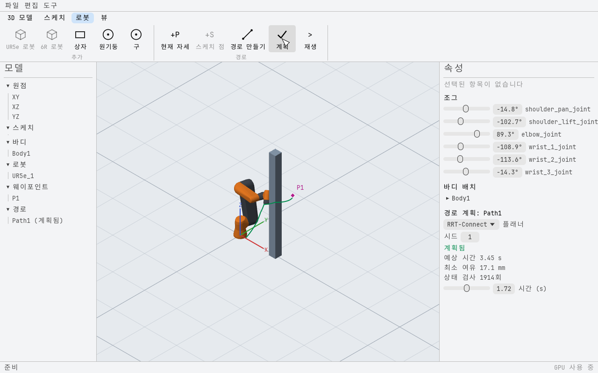

# GraphCTRL 사용자 가이드

로봇 셀(설비, 로봇, 웨이포인트, 경로)을 3D 작업공간에서 스케치하고 계획하는 방법을 순서대로 설명합니다.
화면 이름은 실제 프로그램의 한국어 표기를 그대로 씁니다. 기능 목록과 현재 상태는 [README](../../README.md)와
[진행 상태](../STATUS.md)를 보세요.

| 장 | 내용 |
|---|---|
| 1 | [설치와 실행](#1-설치와-실행) |
| 2 | [첫 실행: 예제 열기](#2-첫-실행-예제-열기) |
| 3 | [화면 구성](#3-화면-구성) |
| 4 | [스케치와 치수](#4-스케치와-치수) |
| 5 | [로봇 추가와 조그](#5-로봇-추가와-조그) |
| 6 | [작업 좌표계](#6-작업-좌표계) |
| 7 | [웨이포인트](#7-웨이포인트) |
| 8 | [경로 계획과 재생](#8-경로-계획과-재생) |
| 9 | [툴](#9-툴) |
| 10 | [포즈 변환 계산기](#10-포즈-변환-계산기) |
| 11 | [저장과 복구](#11-저장과-복구) |
| 12 | [조작 요약](#12-조작-요약) |
| 13 | [측정·간섭 분석·구동](#13-측정간섭-분석구동) |
| 14 | [AI 에이전트 연결 (MCP)](ai-agent.md) |
| 15 | [원점 폴더와 파라미터](#15-원점-폴더와-파라미터) |
| 16 | [구속 대화상자](#16-구속-대화상자-구속--맞춤플러시삽입) |
| 17 | [조인트](#17-조인트) |
| 18 | [구속 한계와 구속 오류](#18-구속-한계와-구속-오류) |
| 19 | [컴포넌트 패턴](#19-컴포넌트-패턴) |
| 20 | [접지와 원점에 배치 (예정)](#20-접지와-원점에-배치) |
| 21 | [마킹 메뉴와 자유 이동·회전](#21-마킹-메뉴와-자유-이동회전) |
| 22 | [파일 가져오기](#22-파일-가져오기) |
| 23 | [접촉 허용과 경로 계획](#23-접촉-허용과-경로-계획) |
| 24 | [자유도 표시 (예정)](#24-자유도-표시-dof) |
| 25 | [미러, 복사, 교체 (예정)](#25-미러-복사-교체) |
| 26 | [뷰와 위치 표현 (예정)](#26-뷰와-위치-표현) |
| 27 | [스케치 도구](#27-스케치-도구-점-다각형-슬롯-간격띄우기-패턴-미러) |
| 28 | [단면 뷰](#28-단면-뷰) |
| 29 | [스케치 편집 도구](#29-스케치-편집-도구) |
| 30 | [배치(Place) 흐름](#30-배치place-흐름) |

---

## 1. 설치와 실행

필요한 것은 [rustup](https://rustup.rs)입니다. Rust 버전은 저장소의 `rust-toolchain.toml`에 고정되어 있어 처음
실행할 때 자동으로 설치됩니다. Windows에서는 Visual Studio Build Tools(“C++를 사용한 데스크톱 개발”)가 필요합니다.

```bash
cargo run -p graphctrl
```

첫 빌드는 의존성 약 470개를 컴파일하므로 몇 분 걸립니다. 두 번째부터는 바뀐 부분만 다시 컴파일합니다.

**빌드 중 메모리 부족 오류**(`rustc-LLVM ERROR: out of memory`, `memory allocation of ... bytes failed`)가 나면
동시에 컴파일하는 크레이트 수를 줄이세요. 이미 끝난 크레이트는 다시 컴파일하지 않습니다.

```bash
cargo run -p graphctrl -j 2
```

매번 붙이기 번거로우면 PowerShell에서 환경 변수로 정해 둘 수 있습니다.

```powershell
$env:CARGO_BUILD_JOBS = "2"
```

숫자가 작을수록 메모리를 덜 쓰고 빌드는 느려집니다.

### 배포할 때: `robots` 폴더
로봇은 실행 파일 안에 들어 있지 않고 실행 파일 밖의 `robots` 폴더에 있습니다. 배포할 때는 실행 파일 옆에 `robots` 폴더를
함께 두세요. 프로그램은 실행 파일 옆, 작업 폴더, 그리고 작업 폴더의 위쪽 네 단계 안에서 `robots` 폴더를 찾습니다.
폴더를 넣거나 빼면 **로봇 추가** 목록이 바뀝니다. 목록은 프로그램을 시작할 때 읽으므로 바꾼 뒤에는 프로그램을 다시 시작하세요. 다시 빌드할 필요는 없습니다.

```text
GraphCTRL.exe
robots/
  ur3e/  ur5e/  ur10e/  ur16e/  sample-6r/
```

각 로봇 폴더(패키지)의 구조는 다음과 같습니다. 자세한 형식은 저장소의 [robots/README.md](../../robots/README.md)를 보세요.

- `robot.json`: 이름, 제조사, 설명 파일, 도달 거리, 가반 하중, 라이선스
- `<설명>.urdf`: 로봇 기술 파일. 메시는 `package://<패키지>/meshes/...`로 참조
- `meshes/visual/`: 화면에 그리는 메시, `meshes/collision/`: 충돌 검사용 메시
- `LICENSE`: 패키지 내용의 라이선스(도움말 > 라이선스에 표시)

프로젝트 파일은 라이브러리 로봇을 `library://<패키지>`로 기억합니다. 그래서 `robots` 폴더 위치가 PC마다 달라도
프로젝트가 열리고, 저장할 때 로봇 메시를 프로젝트 폴더로 복사하지 않습니다.

## 2. 첫 실행: 예제 열기

처음 써 본다면 **파일 > 예제 열기 (UR5e 셀)**를 누르세요. UR5e 로봇, 기둥 바디, 작업 좌표계(Frame1), 웨이포인트
P1·P2, 계획된 경로(Path1)가 들어 있어 기능을 한 번에 볼 수 있습니다.



예제의 값을 바꾸면 경로가 "오래됨"으로 표시됩니다. 그대로 두고 "계획"과 "재생"을 눌러 보세요.

## 3. 화면 구성


| 영역 | 위치 | 하는 일 |
|---|---|---|
| 리본 | 위쪽 | 탭별 명령. **3D 모델**(3D 스케치), **스케치**, **로봇**, **뷰** |
| 모델 브라우저 | 왼쪽 | 원점, 스케치, 파라미터, 바디, 로봇, 좌표계, 웨이포인트, 경로. 체크박스로 보이기/숨기기, `×`로 삭제 |
| 뷰포트 | 가운데 | 3D 작업공간. 오른쪽 위의 ViewCube를 눌러 표준 방향으로 봄 |
| 속성 | 오른쪽 | 선택한 항목의 값. 아무것도 선택하지 않으면 **셀 전체**(조그, 바디 배치, 경로 계획 등) |
| 상태바 | 아래 | 현재 안내 문구, 스케치 구속 상태, GPU 사용 여부 |

- 뷰포트에서 항목에 마우스를 올리면 주황색으로 강조되고, 클릭하면 파란색으로 선택됩니다. 브라우저 선택과 연동됩니다.


- 항목을 우클릭하면 숨기기/보이기, 삭제 등을 할 수 있습니다. Esc는 선택 해제, Delete는 삭제입니다.
- 뷰 조작(Inventor 방식): 휠 = 확대/축소, 가운데 버튼 드래그 = 이동, Shift + 가운데 버튼 드래그 또는 F4 + 왼쪽
  드래그 = 회전, F6 = 홈 화면.

## 4. 스케치와 치수

### 2D 스케치
1. **스케치** 탭에서 XY, XZ, YZ 중 평면을 고르고 스케치를 시작합니다.
2. **작성** 그룹의 선, 원, 호, 사각형 도구로 형상을 그립니다. 단축키는 L(선), C(원), A(호), R(사각형)입니다.
3. **구속** 그룹에서 일치, 수평, 수직, 평행, 직각, 접선 등 구속조건을 넣습니다.
4. **치수** 도구로 길이나 각도를 넣습니다. `25 mm`처럼 단위를 붙이고, `폭 * 2`처럼 수식이나 파라미터 이름을 쓸 수 있습니다.
   치수 값은 더블클릭해서 고칩니다.
5. 상태바에 "N개 치수 필요"가 나오다가 "완전 구속"이 되면 스케치의 위치가 모두 정해진 것입니다.
6. **스케치 마무리**로 나갑니다.

**과구속**: 이미 다른 구속으로 정해진 치수를 넣으면 "참조 치수로 넣을까요?"라고 묻습니다. 참조 치수는 값을 보여 주기만
하고 스케치를 움직이지 않습니다.

**파라미터**(15장 참고): 모델 브라우저의 **파라미터** 표에 `이름`과 `값`(예: `20 mm`)을 넣고 **추가**하면 치수 수식에서 그 이름을
쓸 수 있습니다. 이름을 바꾸면 그 파라미터를 쓰는 치수가 함께 바뀝니다.



### 3D 스케치
로봇 경로를 공간에 그릴 때 씁니다.
1. **3D 모델** 탭 > **3D 스케치**를 누릅니다.
2. 선 도구로 점을 찍어 폴리라인을 만듭니다.
   - 기존 점에 붙일 수 있습니다.
   - 직전 점을 지나는 X, Y, Z 축에 자동으로 잠깁니다.
   - 그 밖에는 **작업 평면** 위에 놓입니다. Tab을 누르면 XY, YZ, ZX 평면이 번갈아 바뀝니다. 상태바에 현재 평면이 표시됩니다.
3. 길이, 높이 치수와 X/Y/Z 방향, 평면 위 구속을 넣을 수 있습니다.



## 5. 로봇 추가와 조그

### 로봇 추가
**로봇** 탭 > **추가** 그룹 > **로봇 추가**에서 `robots` 폴더에 있는 로봇 중 하나를 고릅니다. 기본 패키지는
**UR3e, UR5e, UR10e, UR16e, 6R 로봇**입니다. UR 로봇은 공식 사양에서 만든 모델이며 해석적 역기구학(IK)을 씁니다.
6R 로봇(`sample-6r`)은 기본 도형으로 만든 샘플 6축 팔입니다.

목록에 원하는 로봇이 없으면 같은 형식의 패키지 폴더를 `robots`에 넣고 프로그램을 다시 시작하세요. 사용하지 않는 로봇은
폴더째 빼고 다시 시작하면 목록에서 사라집니다.



다른 로봇은 **URDF 불러오기**로 `.urdf` 파일을 읽을 수 있습니다. 메시(STL, COLLADA)는 URDF 파일이 있는 폴더 주변에서
찾습니다. 찾지 못한 메시가 있으면 그 부분은 그려지지도, 충돌 검사에도 들어가지 않는다는 알림이 나옵니다.

### 로봇 베이스와 TCP
로봇을 선택하면 속성에 다음 항목이 나옵니다.
- **로봇 베이스**: 로봇이 놓인 위치(mm)와 회전(도).
- **툴 중심점(TCP)**: 플랜지에서 툴 끝까지의 오프셋. 툴을 달았다면 [9. 툴](#9-툴)에서 "TCP를 툴 끝으로"를 누르면
  툴 끝이 TCP가 됩니다.

### 조그
**조그** 슬라이더와 입력 칸으로 관절을 움직입니다. 자세가 충돌하면 해당 링크가 붉게 표시되고, 속성 패널에 충돌하는 두 부분이 나옵니다.
관절 한계를 넘으면 그 관절이 표시됩니다.

**투명도** 슬라이더(0~95 %)로 바디나 로봇을 비쳐 보이게 할 수 있습니다. 화면만 바뀌고, 숨기거나 투명한 설비도
경로 계획에서는 계속 장애물입니다.


### 바디(설비)
- **상자, 원기둥, 구**: 추가 그룹의 버튼으로 기본 도형을 넣고, 속성에서 위치(mm)·크기(mm)·회전(도)를 입력합니다.
- **메시 불러오기**: STL 파일을 바디로 넣습니다. 파일 단위가 mm이면 **배율**이 자동으로 m로 환산됩니다.
- 기즈모(아래 [7장](#7-웨이포인트))로 끌어서 옮길 수도 있습니다.

## 6. 작업 좌표계

설비 위의 기준점(예: 파지 위치, 작업대 모서리)을 원점으로 하는 좌표계를 만듭니다. 로봇 컨트롤러의 3점 사용자 좌표계와
같은 방식입니다.

1. 스케치에서 점을 하나 만들고 치수나 **고정** 구속으로 **완전히 구속**합니다. 구속되지 않은 점은 좌표계의 원점이 될 수 없습니다.
2. 그 점을 선택하고 **로봇** 탭 > **좌표계**를 누릅니다. 점 하나면 스케치 축을 씁니다.
3. 방향까지 정하려면 점을 **Ctrl + 클릭**으로 차례대로 2~3개 고릅니다.
   - 1번 점: 원점
   - 2번 점: X축이 향하는 점
   - 3번 점: XY 평면 위의 점(+Y 쪽)
   - 점이 2개면 Z는 스케치 법선입니다.
4. 속성 패널에서 축 점을 바꾸거나 R/P/Y로 더 돌릴 수 있습니다.
5. 좌표계의 6축 값(X, Y, Z, R, P, Y와 UR 회전 벡터)이 **월드 기준**과 **로봇 베이스 기준**으로 표시됩니다.


원점 치수를 바꾸면 그 좌표계를 기준으로 한 웨이포인트와 경로가 함께 움직입니다(경로는 "오래됨"이 됩니다).

## 7. 웨이포인트

웨이포인트는 로봇이 거쳐 갈 자세입니다. 만드는 방법은 세 가지입니다.

| 버튼 | 만들어지는 것 |
|---|---|
| **현재 자세** | 지금 로봇 자세를 그대로 저장 |
| **스케치 점** | 스케치에서 고른 점을 따라다니는 웨이포인트. 스케치를 고치면 따라 움직임 |
| **좌표계 기준** | 로봇의 현재 TCP 자세를 선택한 좌표계 기준으로 저장 |

### 기준 좌표계
웨이포인트의 위치와 자세는 **기준 좌표계**(월드, 로봇 베이스(UR 티치펜던트의 Base), 작업 좌표계 중 하나)에서 표시됩니다.
기준을 바꿔도 로봇이 가는 자세는 그대로이고, 표시되는 값만 바뀝니다.

속성의 **다른 좌표계에서 본 값**을 펼치면 같은 자세를 다른 기준으로 본 숫자와 변환 행렬을 볼 수 있습니다.


### 기즈모로 옮기기
선택한 바디, 로봇, 좌표계 기준 웨이포인트에는 기즈모가 나타납니다.
- **X/Y/Z 화살표**를 끌면 그 축으로 움직입니다. 1 mm 단위, Shift를 누르면 10 mm, Ctrl을 누르면 자유롭게 움직입니다.
- **빨강/초록/파랑 링**을 끌면 X/Y/Z축으로 회전합니다. 1° 단위, Shift를 누르면 15°, Ctrl을 누르면 자유롭게 돌립니다.
- 끄는 동안 이동량이 옆에 표시되고, 놓으면 실행 취소 한 단계로 기록됩니다.
- 좌표계는 원점이 구속된 점이라 회전 링만 나옵니다.

### 고스트 로봇
웨이포인트나 경로의 점을 선택하거나 가리키면 그 자세의 로봇이 **반투명**하게 나타납니다. 도달할 수 없거나 문제가 있으면
붉게 표시되고, 속성 창에 도달 여부와 관절값이 나옵니다.



선택한 항목에는 기즈모가 나옵니다.


### 웨이포인트 순서
**경로** 항목에서 웨이포인트를 **↑ ↓**로 옮기거나, **빼기**로 경로에서 빼고, **웨이포인트 추가**로 다시 넣습니다.
순서 편집도 실행 취소 한 단계로 되돌릴 수 있습니다.

## 8. 경로 계획과 재생

1. 웨이포인트를 여러 개 고른 뒤 **로봇** 탭 > **경로 만들기**를 누릅니다.
   - 스케치에 그려 둔 선이 있다면 **스케치 경로**를 누릅니다. 선의 끝점이 웨이포인트가 되고, 각 선은 직선 이동이 됩니다.
2. 경로를 선택하면 **경로 계획** 섹션이 나옵니다.
   - 웨이포인트마다 **자유 이동**과 **직선 이동(LIN)** 중 하나를 고릅니다. 직선 이동은 툴 끝이 직선으로 움직입니다.
   - **직선 이동 TCP 속도 제한**을 켜면 직선 구간의 툴 속도가 상한을 넘지 않도록 궤적을 고르게 늦춥니다.
   - **플래너**: RRT-Connect(기본), RRT, RRT*, Informed RRT*, PRM 중 고릅니다. 시드를 바꾸면 결과가 달라집니다.
3. **계획**을 누릅니다. 계획은 작업 스레드에서 돌고, **취소**할 수 있습니다.
4. 결과 카드에 예상 시간, 최소 여유(장애물까지 거리), 상태 검사 횟수, 최대 TCP 속도가 나옵니다.
5. **재생**으로 움직임을 봅니다. **정지**로 멈춥니다. 시간(s) 값으로 특정 시점을 볼 수 있습니다.

**오래됨**: 장애물, 스케치, 웨이포인트, 좌표계 등을 고치면 경로에 "오래됨(다시 계획 필요)"이 붙습니다. 그 상태로
재생하면 이전 계획이 보이므로 다시 계획하세요.

**알고리즘 비교**: 경로 계획 섹션의 **알고리즘 비교**는 모든 플래너를 같은 경로에 돌려 성공률, 예상 시간, 검사 수를 표로
보여 줍니다. 표 위에 "이전 상태 기준 결과"가 나오면 셀을 고친 뒤 다시 실행하세요.






## 9. 툴

로봇의 **툴** 섹션에서 툴 끝에 붙는 형상을 정합니다.

- **툴 형상**: 없음, 원기둥, 상자, 구, 메시 파일 중 하나. **메시 파일에서 불러오기…**로 STL을 읽습니다.
- **크기**와 **위치, 회전**으로 플랜지 기준 위치를 맞춥니다.
- 툴은 로봇 링크의 일부로 충돌 검사와 경로 계획에 들어갑니다.
- **TCP를 툴 끝으로**를 누르면 TCP가 툴 끝으로 옮겨집니다.


## 10. 포즈 변환 계산기

**도구 > 포즈 변환 계산기**에서 위치와 자세를 계산합니다.

- **회전 입력**: RPY(도), 회전벡터(rad), 쿼터니언 중 고릅니다. UR 컨트롤러가 쓰는 형식은 회전벡터입니다.
- **포즈 A, 포즈 B**: 위치와 회전을 입력합니다. **선택한 웨이포인트 → A**로 웨이포인트 값을 가져올 수 있습니다.
- **A의 기준**과 **변환할 기준**을 고르면 A를 다른 기준에서 본 값을 보여 줍니다.
- **A · B**(합성), **A^-1**(역변환), **A^-1 · B**(A에서 본 B)를 계산합니다. **복사**로 결과를 옮길 수 있습니다.


## 11. 저장과 복구

- **파일 > 저장**(Ctrl+S), **다른 이름으로 저장**(Ctrl+Shift+S), **열기**(Ctrl+O), **새로 만들기**(Ctrl+N).
- 프로젝트는 `이름.gctrl` 파일입니다. 불러온 메시와 URDF 로봇의 메시 파일은 옆의 `이름_files` 폴더에 복사됩니다.
  `.gctrl` 파일과 `_files` 폴더를 **함께** 옮기면 다른 PC에서도 열립니다.
- **파일 > 최근 프로젝트**에 최근 8개가 남습니다.
- 저장하지 않은 작업은 1분마다 자동 저장됩니다. 프로그램이 비정상 종료되면 다음 실행 때 복구할지 묻습니다.
  자동 저장 파일은 Windows에서 `%APPDATA%\GraphCTRL`, Linux에서 `~/.config/graphctrl`에 있습니다. 복구한 작업은
  저장해야 남습니다.
- **도움말 > 정보**에서 버전과 설정·복구 폴더를 확인할 수 있습니다.
- **편집 > 실행 취소**(Ctrl+Z)와 **다시 실행**(Ctrl+Y)으로 편집을 되돌리거나 다시 합니다. 기즈모 이동과 웨이포인트 순서 편집도 한 단계씩 되돌릴 수 있습니다.

## 12. 조작 요약

| 입력 | 동작 |
|---|---|
| 휠 | 확대/축소 |
| 가운데 드래그 | 이동 |
| Shift + 가운데 드래그, F4 + 왼쪽 드래그 | 회전 |
| F6 | 홈 화면 |
| L, C, A, R | 스케치 도구: 선, 원, 호, 사각형 |
| Tab | 3D 스케치 작업 평면 전환(XY → YZ → ZX) |
| Ctrl + 클릭 | 좌표계 점을 순서대로 여러 개 고르기 |
| Esc | 도구 취소, 선택 해제 |
| Delete | 선택 항목 삭제 |
| Ctrl+Z / Ctrl+Y | 실행 취소 / 다시 실행 |
| Ctrl+N / Ctrl+O / Ctrl+S | 새로 만들기 / 열기 / 저장 |

## 13. 측정·간섭 분석·구동

세 기능은 모두 **도구** 메뉴에 있습니다. 측정과 간섭 분석은 창을 연 채로 뷰포트와 브라우저에서 항목을 고르고, 구동은
로봇 관절을 정해진 순서로 움직여 봅니다. 현재 구현 범위와 Inventor와의 차이는
[어셈블리 환경 동등성 명세 §3.6.1](../ux/inventor-assembly-parity.md)에 있습니다.

### 측정 (도구 > 측정)
1. **도구 > 측정**을 엽니다. 창에 "선택 1"과 "선택 2"가 나타납니다.
2. 뷰포트나 브라우저에서 항목을 고릅니다. 첫 번째는 선택 1, 두 번째는 선택 2에 들어갑니다. 빈 곳을 클릭하면 다시 시작합니다.
3. 선택 우선순위를 고릅니다.
   - **컴포넌트 우선**: 바디, 로봇, 웨이포인트, 좌표계 단위로 고릅니다. 두 개를 고르면 **최소 거리**가 나옵니다.
   - **모서리 및 면 우선**: 메시의 모서리와 면, 꼭짓점을 고릅니다. 모서리 길이, 면 면적, 점 위치가 나옵니다.
4. 두 항목을 고르면 거리와 좌표 차이(Δ X, Y, Z), Z축 사이 각도가 나옵니다. 거리는 **최소 거리**, **중심 간 거리**, **최대 거리** 중에서 바꿔 볼 수 있습니다(컴포넌트 두 개를 고른 경우).
5. 값을 누르면 복사할 수 있고, **모두 복사**로 한꺼번에 복사할 수 있습니다. **완료**를 누르면 창을 닫습니다.

> 기준 UCS 선택은 아직 없습니다. 좌표를 다른 좌표계 기준으로 보려면 웨이포인트의 "다른 좌표계에서 본 값"을 쓰세요(7장).

### 간섭 분석 (도구 > 간섭 분석)
1. **도구 > 간섭 분석**을 엽니다.
2. **세트 #1 정의**를 누른 뒤 컴포넌트를 고릅니다. 다시 고르면 빠집니다. **세트 #2 정의**도 같은 방식입니다.
   - 세트 #2가 비어 있으면 **세트 #1 안에서 서로** 검사합니다.
   - **모든 컴포넌트를 세트 #1에**를 누르면 로봇과 바디 전부가 들어갑니다.
3. 분석 결과에 간섭 개수, 총 체적, 항목마다 체적과 중심 좌표(mm)가 나옵니다.
4. 항목을 **두 번 클릭**하면 그 간섭 영역으로 확대됩니다. 뷰포트에는 간섭 영역이 빨간 점으로 표시됩니다.
5. **무시**로 확인이 끝난 간섭을 뺄 수 있습니다. **이 체적 이하 모두 무시**로 작은 간섭을 한꺼번에 뺄 수 있고, **무시 해제**로 되돌립니다. "무시한 항목 표시"를 켜면 무시한 항목이 취소선과 함께 보입니다.
6. **다시 분석**으로 세트를 고쳐 다시 검사합니다.

> 체적은 충돌 형상 위의 격자 표본으로 **추정**한 값입니다. 나사 같은 항목을 거르는 필터는 아직 없습니다.

### 구동 (도구 > 구동)
1. **도구 > 구동**을 엽니다. 로봇과 관절을 고릅니다.
2. **시작**은 지금 관절값, **끝**은 시작 + 10으로 정해집니다. **일시 중지 지연(초)**으로 한 단계 사이의 시간을 정합니다.
3. **자세히**를 펼치면 다음을 정할 수 있습니다.
   - **충돌 감지**: 체크하면 충돌하는 순간 멈추고 원인을 표시합니다.
   - **증분**: 값의 양(예: 5°씩) 또는 총 단계 수.
   - **반복**: **시작/끝**(한 번 가고 시작으로 돌아옴) 또는 **시작/끝/시작**(가고 오기), 그리고 반복 횟수.
4. **정방향**, **역방향**, **중지**, **한 단계 앞으로/뒤로**, **시작으로**, **끝으로**로 움직입니다.
5. 충돌하면 멈추고 충돌 쌍이 표시됩니다.
6. 구동 창을 닫으면 로봇은 **원래 자세로 돌아갑니다**. 구동은 셀 문서를 바꾸지 않습니다.

> 한 번에 관절 하나만 구동합니다. 여러 관절을 연결하는 방정식과 구동 중 자동 조정(적응성), 동작 기록(동영상)은 아직 없습니다.

## 15. 원점 폴더와 파라미터

### 원점 폴더
- 원점 폴더는 **컴포넌트마다** 있습니다. 바디, 로봇, 가져온 어셈블리 각각 자기 원점 평면(XY, XZ, YZ), 축(X, Y, Z), 중심점을 가집니다.
- 모델 브라우저의 원점 폴더에서 항목을 **켜고 끌** 수 있습니다. 뷰포트에서 원점 평면을 클릭해 고를 수 있습니다.
- 원점 평면에서 **우클릭 > 스케치 만들기**를 누르면 그 평면 위에 스케치를 시작합니다(스케치 탭의 평면 버튼과 같은 결과).

### 매개변수 (관리 > 매개변수)
매개변수는 값에 이름을 붙여 여러 곳에서 쓰는 표입니다. **관리** 탭 > **매개변수** 패널 > **매개변수**(fx 아이콘)를 누르면 대화상자가 열립니다.

- **모델 매개변수**: 스케치 치수 목록입니다. 치수가 "거리", "각도", "반지름" 등으로 나오고, 참조 치수는 `(참조)`로 표시되어 수식을 바꿀 수 없습니다.
- **사용자 매개변수**: 이름, 단위(mm 또는 deg), 수식, 공칭 값을 가진 표입니다. 여기서 값을 새로 정합니다.
- **검색** 칸에 적으면 이름, 수식, 값, 단위 전체에서 행을 거릅니다.
- **숫자 추가**: 단위(mm 또는 deg)를 고른 뒤 누르면 `Param`, `Param2`처럼 빈 이름으로 `0 mm` 또는 `0 deg` 매개변수가 생깁니다. 이름과 수식은 행에서 고칩니다.
- **수식 입력 후 Enter**를 누르면 적용됩니다. 잘못된 수식이면 대화상자 아래에 이유가 나옵니다.
- 행을 **우클릭**하면 **매개변수 삭제**, **사용자 매개변수에 복사**가 나옵니다. 복사본은 `이름_copy`(이미 있으면 번호가 붙음)로 만들어집니다.

치수 수식에서 파라미터 이름을 그대로 씁니다. 예: `폭`이라는 파라미터가 있으면 치수에 `폭 * 2`라고 씁니다. 파라미터를 바꾸면 그것을 쓰는 치수가 함께 바뀝니다.

- **이름 바꾸기**: 사용자 매개변수의 이름 칸을 고쳐 **Enter**를 누르면 이름이 바뀌고, 그 이름을 쓰는 수식도 함께 따라갑니다.
- **모델 매개변수의 이름**: 치수에 이름이 없으면 `스케치1 · 거리 1`처럼 위치로 보입니다. 이름이 없는 치수에는 `d0`, `d1`처럼 쓰이지 않은 다음 이름이 자동으로 붙고, 이름이 있으면 그 뒤에 위치가 괄호로 붙습니다. 예: `d0 (스케치1 · 거리 1)`.

## 16. 구속 대화상자 (구속 · 맞춤·플러시·삽입)

**로봇** 탭 > **관계** 그룹 > **구속**을 누르면 구속 대화상자가 열립니다. 두 구성요소의 **원점 요소**를 골라 위치 관계를 줍니다. 자유도를 얼마나 제한할지는 유형이 정합니다.

| 유형 | 하는 일 |
|---|---|
| **맞춤(Mate)** | 면을 마주 보게 하거나 점·축을 맞춥니다. 방향은 **반대**, **정렬**, **방향 없음** 중에서 고릅니다. |
| **플러시(Flush)** | 면을 같은 방향으로 나란히 맞춥니다. |
| **삽입(Insert)** | 축과 면을 함께 맞춥니다(볼트를 구멍에 넣는 것과 같음). **정렬**을 체크하면 방향이 바뀝니다. |

사용법:
1. 유형을 고릅니다.
2. **오프셋 및 방향 예측**을 체크하면 두 선택이 가까울 때 현재 거리와 방향을 추론해 넣습니다.
3. **첫 번째**를 누른 뒤 뷰포트에서 원점 요소(XY·XZ·YZ 평면, X·Y·Z 축, 중심점, 또는 조인트 원점)를 클릭합니다. 그다음 **두 번째**를 누르고 클릭합니다. 다시 누르면 그 선택을 바꿉니다.
4. **오프셋**(mm)을 넣습니다.
5. **확인**은 구속을 만들고 닫습니다. **적용**은 만들고 계속합니다. **취소**는 닫습니다.

> 현재는 원점 요소끼리만 구속할 수 있습니다. 임의의 면을 고르는 것, 한계(최대·최소) 설정, 구속 관리 목록은 아직 없습니다. 구속이 서로 충돌하거나 풀 수 없으면 구속은 만들어지지 않습니다(이유 표시는 아직 없습니다).

## 17. 조인트

조인트는 구성요소가 **어떻게 움직일 수 있는지**를 정합니다. 조인트 대화상자는 **관계** 그룹의 **조인트**에서 열고, 키보드에서는 **J**를 누릅니다(스케치 중에는 J가 다른 뜻입니다).

| 종류 | 자유도 | 쓰는 곳 |
|---|---|---|
| **자동** | 두 원점을 보고 고릅니다. 원형 원점이면 회전, 아니면 강체 | 기본값 |
| **강체(Rigid)** | 원점 좌표계를 완전히 맞춤(움직임 없음) | 볼트로 고정한 부품, 툴을 플랜지에 붙이기 |
| **회전(Rotational)** | 축을 맞추고 그 축 둘레의 회전은 허용 | 관절, 베어링 |

사용법:
1. 조인트 대화상자에서 종류를 고릅니다.
2. **첫 번째 원점**: 움직일 구성요소의 원점 요소를 뷰포트에서 클릭합니다.
3. **두 번째 원점**: 그대로 있을 구성요소의 원점 요소를 클릭합니다.
   - 원점 요소는 XY·XZ·YZ 평면, X·Y·Z 축, **중심점**입니다. 중심점은 구성요소 원점 좌표계 전체를 뜻합니다.
4. 방향이 반대면 **구성요소 뒤집기**를 체크합니다.
5. **확인**은 만들고 닫고, **적용**은 만들고 계속합니다.

> 조인트 명령이 두 구성요소의 원점을 맞출 수 없으면 구속을 풀 수 없다는 메시지가 상태 줄에 나오고 만들어지지 않습니다.
> 조인트 **한계**(최대·최소 회전 범위)는 아직 예정입니다(18장).

## 18. 구속 한계와 구속 오류

- **한계**(최대, 최소, 정지 위치) 입력은 **예정**입니다. 구속 대화상자의 "더 보기"는 아직 없습니다.
- **구속 오류 대화상자**: 새 구속이 기존 구속과 함께 풀리지 않으면 **구속 오류** 창이 열립니다. 그 새 구속과 충돌하는 기존 구속들을 나열하고, 각각 **억제**하거나 **삭제**할 수 있습니다. 고르고 나면 새 구속을 다시 배치합니다. 취소하면 새 구속은 만들어지지 않습니다. 풀 수 없는 상태에서 아무것도 고르지 않으면 상태 줄에 **구속을 풀 수 없습니다**가 나옵니다.
- 구속을 지우려면 브라우저의 구속 항목에서 삭제합니다.

## 19. 컴포넌트 패턴

컴포넌트 패턴은 구성요소를 **일정한 간격의 열과 행**, 또는 **축 둘레의 원형 배열**로 복사합니다. 복사본은 실제 구성요소이고, 원본을 고치면 복사본도 따라 움직입니다.

1. **조립** 탭 > **패턴** 그룹 > **패턴**을 누릅니다. 구성요소가 하나 이상 있어야 합니다.
2. **패턴화할 컴포넌트**: 복사할 구성요소를 고릅니다.
3. 방식을 고릅니다.
   - **사각형**: **열**과 **행** 방향을 정합니다. 방향은 원점 축, 모서리, 작업 축, 면 중에서 고릅니다. **간격**(mm)과 **개수**를 넣고, **뒤집기**로 방향을 바꾸고, **중간 평면**을 체크하면 원본 양쪽으로 펼칩니다.
   - **원형**: **회전 축**을 고르고 **개수**와 **각도**(°)를 넣습니다. 각도는 **증분**(복사본 사이 각도) 또는 **맞춤**(전체 각도) 중 하나입니다. **회전**은 복사본이 돌면서 놓이고, **고정**은 원본과 같은 방향을 유지합니다.
4. **확인**은 패턴을 만들고 닫고, **적용**은 계속합니다.

모델 브라우저의 **패턴** 항목에서 패턴을 찾을 수 있습니다.

> 패턴을 만든 뒤 개수를 바꾸면 복사본이 늘거나 줄어듭니다. 복사본을 원본과 떼어 독립 구성요소로 만드는 기능은 아직 화면에 없습니다(예정).

## 20. 접지와 원점에 배치

- **접지(Grounded)**: 구성요소를 공간의 제자리에 고정해 다른 구속이 움직이지 않게 합니다. 바디나 로봇을 고른 뒤 **조립** 탭 > **위치** 그룹 > **접지**를 누릅니다. 접지된 항목은 버튼이 눌린 상태로 보입니다. 다시 누르면 접지를 풉니다. 상태 줄에 "접지했습니다"와 "접지를 풀었습니다" 안내가 나옵니다.
- **원점에 배치**: 구성요소의 원점을 월드 원점에 맞추는 기능입니다. 화면 명령은 **예정**입니다. 지금은 바디·로봇의 위치를 15장의 원점 폴더와 배치 입력으로 맞춥니다.

## 21. 마킹 메뉴와 자유 이동·회전

구성요소는 뷰포트나 모델 브라우저에서 클릭해 고릅니다.

로봇 셀에서 뷰포트를 **우클릭**하면 방사형 메뉴가 커서 둘레에 나옵니다.

| 방향 | 명령 |
|---|---|
| 위 | 구속 대화상자 열기 |
| 오른쪽 | 컴포넌트 이동(자유 이동) |
| 아래 | 컴포넌트 회전(자유 회전) |
| 왼쪽 | 부품 배치 |

메뉴 항목을 누르지 않고 항목 쪽으로 획을 긋고 떼면 바로 선택됩니다(제스처). 짧은 목록은 방사형 메뉴 근처에 함께 나오며, 원점 평면에서는 **스케치 만들기**, 항목에서는 표시/숨기기, 계획, 삭제가 나옵니다. 홈, 전체 보기도 여기 있습니다.

- **자유 이동**: 뷰 평면 안에서 구성요소를 끌어 옮깁니다.
- **자유 회전**: 구성요소의 원점 둘레로 돌립니다.
- 드래그 한 번이 실행 취소 한 단계입니다. **Esc**로 도구를 끝냅니다.

## 22. 파일 가져오기

**추가** 그룹의 **메시 불러오기**와 파일 열기 대화상자에서 다음 형식을 가져옵니다.

| 형식 | 확장자 | 설명 |
|---|---|---|
| STL | `.stl` | 삼각형 메시. mm 단위 파일은 자동으로 m로 환산 |
| COLLADA | `.dae` | 재질별 색과 노드 변환을 읽음 |
| glTF / GLB | `.gltf`, `.glb` | 어셈블리 파일로 가져와 구성요소로 넣음 |
| STEP | `.stp`, `.step` | **AP242 테셀레이션(삼각형이 들어 있는 파일)만** 읽습니다. 테셀레이션이 없는 B-rep 전용 STEP은 읽지 못합니다 |

> STEP 파일은 열기 전에 테셀레이션 포함 여부를 확인하세요. 읽지 못하면 상태 줄에 **가져오기 실패: 이유**가 나옵니다.

**가져오기 진행**: 큰 파일은 메시를 나눠 올리므로 상태 줄에 **불러오는 중… (메시 N개 남음)**이 나오고, 끝나면 사라집니다.

**조립** 탭 > **배치** 버튼으로도 같은 목록의 파일(STEP, GLB 포함)을 구성요소로 가져옵니다. 배치의 연속 놓기 흐름은 30장을 보세요. 가져온 구성요소는 브라우저에 나타나며 접지, 구속, 패턴에 쓸 수 있습니다.

## 23. 접촉 허용과 경로 계획

경로 계획에서는 어떤 링크가 어떤 장애물과 **닿아도 되는지**를 정할 수 있습니다. 경로 항목의 **접촉 허용** 섹션에서 추가합니다.

- **접촉 허용 추가**: 링크와 장애물을 고르고, 몇 번째 이동에 적용할지 정합니다.
- **이동 전체**: 체크하면 그 경로의 모든 이동에 적용합니다.
- **겹침 허용**: 체크하면 그 링크와 장애물이 겹치는 것을 허용합니다.
- 항목 옆의 **×**로 지웁니다.

접촉 허용 구간에서는 패딩이 0이 됩니다. 이 기능은 **계획**에만 쓰입니다.

### 접촉 솔버와 접촉 세트
접촉 허용(위)은 경로 계획의 규칙입니다. 접촉 솔버는 별도의 설정입니다.

- **접촉 세트**: 브라우저의 구성요소를 우클릭하고 **접촉 세트**를 체크하면 그 구성요소가 접촉 세트에 들어갑니다.
- **접촉 솔버**: **검사** 탭 > **접촉 솔버** 메뉴에서 고릅니다. **끔**, **접촉 세트만**(접촉 세트에 든 구성요소끼리만), **모든 컴포넌트** 중 하나입니다.

접촉 솔버를 켜면 구동과 드래그가 접촉을 따라 움직입니다.

- **구동**(13장)은 2 mm(회전은 1°)씩 나아갑니다. 움직일 수 있는 **자유 바디**는 접촉면의 법선 방향으로 밀려나고, 접지되었거나 관계로 묶여 있거나 구동 중이거나 **로봇**에 닿는 것은 밀지 못하므로 그 직전 값에서 멈춥니다.
- **드래그**(바디 미리보기)도 같은 규칙을 따릅니다. 놓으면 밀려난 바디까지 **실행 취소 한 단계**로 묶입니다.
- **숨김, 비활성, 억제**된 구성요소는 이 계산에 들어가지 않습니다.
- 어셈블리 부품은 보이는 단단한 물체로 들어갑니다. 배율을 준 부품은 제외됩니다.

접촉 허용(위)과는 다른 기능입니다. 접촉 허용은 경로 계획의 규칙이고, 접촉 솔버는 움직이는 동안의 접촉 처리입니다.

## 24. 자유도 표시 (DOF)

상태 줄에는 스케치가 아직 필요한 치수 수나 **완전 구속**이 나옵니다. 구성요소의 자유도 기호는 **뷰** 탭 > **가시성** 그룹의 **자유도**로 켜고 끕니다. 고른 항목에 자유도 기호가 나타나며, 한 번 더 누르면 숨깁니다. 기호가 나타나는 방식의 세부는 확인 중입니다.

## 25. 미러, 복사, 교체

구성요소를 다루는 세 가지 명령입니다. 대화상자가 열려 있는 동안 원하는 구성요소를 뷰포트에서 고릅니다.

- **미러**(조립 탭 > 패턴 그룹): 원점 평면을 대칭면으로 골라 구성요소를 거울에 대칭으로 복사합니다. 대칭면을 우클릭하면 바꿀 수 있습니다.
- **복사**(조립 탭 > 패턴 그룹): 구성요소를 오프셋만큼 옮긴 복사본을 만듭니다. **관계 복사**를 켜면 복사본에 원본과 같은 관계를 줍니다.
- **교체**(조립 탭 > 구성 그룹의 교체 명령, 배치 옆): 구성요소를 다른 형상으로 바꿉니다. **모두 교체**를 고르면 같은 원본을 쓰는 구성요소를 전부 바꿉니다.

풀 수 없는 관계는 억제되고, 대화상자에 목록으로 나옵니다.

> 복사본과 교체의 세부 동작은 원문과 다를 수 있습니다. 파일 이름을 묻는 대화상자는 없습니다.

## 26. 뷰와 위치 표현

브라우저의 **표현** 폴더에는 두 종류가 있습니다.

- **뷰 표현**: 보이는 항목, 구성요소의 사용 상태(사용 가능 여부), 투명도, 카메라를 저장해 두는 표현입니다.
- **위치 표현**: 구성요소의 자리와 관계의 값, 억제 상태를 저장합니다. **[Primary]**는 기본 상태이고, 편집할 수 없습니다. 새 위치 표현은 Primary를 복사해서 만들고, 하나만 활성으로 둘 수 있습니다.

표현을 고르면 그 상태가 화면에 적용됩니다. 표현 복사와 Model State는 아직 없습니다.

> 엑셀 편집과 검증(Verify)도 아직 없습니다.

## 27. 스케치 도구 (점, 다각형, 슬롯, 간격띄우기, 패턴, 미러)

스케치 탭에서 다음 도구를 씁니다. 각 도구는 실행 중 상태 줄에 다음에 할 일을 안내합니다.

| 그룹 | 도구 | 쓰는 법 |
|---|---|---|
| 작성 | **점**, **중심점** | 점을 놓을 곳을 클릭합니다(안내: "점을 놓을 곳을 클릭하십시오"). |
| 작성 | **다각형** | 중심을 클릭하고, 옵션 창에서 **내접** 또는 **외접**과 **변 수**를 정합니다. 내접은 꼭짓점을, 외접은 변의 중점을 클릭해 크기를 정합니다. |
| 작성 | **슬롯** | 세 종류: **중심 대 중심 슬롯**, **전체 슬롯**, **중심점 슬롯**. 첫 점과 두 번째 점을 클릭하고, 너비는 클릭하거나 값을 입력합니다. |
| 수정 | **간격띄우기** | 간격띄울 곡선을 고르고 위치를 클릭하거나 거리를 입력합니다. 옵션 창의 **루프 선택**과 **간격띄우기 구속**은 우클릭으로도 켜고 끕니다. |
| 패턴 | **직사각형** | 형상을 고르고, **방향 1**과 **방향 2** 각각에 **개수**와 **간격**(수식)을 넣습니다. **뒤집기**와 **맞춤**을 쓸 수 있습니다. |
| 패턴 | **원형** | 형상을 고르고, **축**(점 또는 원의 중심)을 고릅니다. **개수**, **각도**(수식), **뒤집기**, **맞춤**을 정합니다. |
| 패턴 | **미러** | 형상을 고르고 **대칭선**을 고릅니다. **적용**은 계속하고 **완료**는 닫습니다. |

**리본 분할 버튼**: 선, 원, 호, 직사각형, 슬롯은 ▾ 버튼으로 변형 목록을 펼칩니다. 큰 버튼 본체에는 마지막으로 쓴 변형이 남고, 세션 동안 기억됩니다. 작성 그룹의 작은 버튼으로는 점, 중심점, 다각형을 씁니다. 3D 스케치는 선과 호 분할 버튼을 씁니다.

**중점 선·접선 원·중심 직사각형**: 중점 선은 한 점을 중점으로 찍고 끝점을 찍습니다(길이·각도 입력 칸은 없습니다). 접선 원은 세 선에 접하는 원입니다. 중심 직사각형은 **2점**과 **3점** 두 종류입니다.

**창을 연 채로 고르기**: 패턴과 미러의 옵션 창은 열린 채로 둡니다. 형상, 대칭선, 방향, 축의 "← 선택" 단추를 누르면 그 칸이 선택 모드가 되고, 뷰포트에서 클릭한 항목이 그 칸에 들어갑니다. 상태 줄이 무엇을 고를지 안내합니다. 선택 모드인 동안에는 끌기와 Delete가 막힙니다. 단추를 다시 누르면 선택 모드가 꺼집니다.

**호 슬롯**: 슬롯에 **3점 호 슬롯**과 **중심점 호 슬롯** 두 종류가 더 있습니다. 슬롯 중심이 호이므로 중심 호의 중심, 지나는 점, 끝을 차례로 클릭합니다.

**점 입력**: 점 도구는 커서 옆의 입력 칸에 **X**와 **Y** 값을 넣을 수 있습니다. 숫자를 입력하고 **Tab**으로 칸을 잠그고 다음 칸으로, **Shift+Tab**으로 앞 칸으로 갑니다. **Enter**는 잠근 값으로 점을 놓고, **Esc**는 도구를 끝냅니다.

**패턴 편집**: 패턴이 만든 곡선을 고른 채 스케치 탭 **패턴** 그룹의 **직사각형 패턴** 또는 **원형 패턴** 버튼을 누르면, 값이 채워진 편집 창이 열립니다. 별도의 편집 버튼은 없습니다.
- **억제**: 억제 칸에서 패턴의 요소를 골라 뺍니다(억제: 요소 N개). **확인**은 패턴을 다시 만듭니다.
- **패턴 삭제**: 패턴을 지웁니다.
- 원본을 지우면 그 패턴도 함께 지워집니다.

## 28. 단면 뷰

**뷰** 탭 > **외형** 그룹의 **1/2 단면**, **1/4 단면**, **3/4 단면** 중 하나를 누르면 단면 캡이 나타나 구성요소를 잘라 보여 줍니다.

- **위치**: 자르는 평면의 위치를 정합니다. **뒤집기**로 잘라 낼 쪽을 바꿉니다.
- **확인**과 **취소**로 정합니다. **계속**은 단면을 정한 뒤 다음 단계로 넘어갑니다.
- **단면 삭제**로 단면 뷰를 끕니다.

> 단면 캡의 색과 해칭, 단면 평면 핸들의 모양은 명세와 다를 수 있습니다.

## 29. 스케치 편집 도구

스케치 탭의 **수정** 그룹과 다른 그룹에 있는 편집 도구입니다. 대부분 실행 중 상태 줄에 안내가 나옵니다.

| 도구 | 하는 일 | 쓰는 법 |
|---|---|---|
| **이동**, **복사**, **회전** | 형상을 옮기거나, 복사하거나, 돌립니다 | 형상을 고르고, 기준점을 클릭한 뒤 끝점을 클릭합니다. 옵션 창의 **More** 상자에서 Always 또는 Never를 고를 수 있습니다. |
| **축척** | 형상의 크기를 비율로 바꿉니다 | 형상을 고르고 기준점을 클릭한 뒤 끝점을 클릭하거나 비율을 입력합니다. 비율의 기준은 가장 먼 선택 점까지의 거리를 1로 봅니다. |
| **신축** | 선택한 점만 움직여 형상을 늘이거나 줄입니다 | 기준점과 끝점을 정합니다. 구속이 막으면 자유로운 형상은 늘어나지 않고 통째로 미끄러집니다. |
| **분할** | 곡선을 교차점에서 나눕니다 | 분할할 곡선을 클릭하면 가장 가까운 교차점에서 나뉩니다. 원은 한 교차점으로는 나눌 수 없어 거부합니다. |
| **모따기** (2D) | 두 선의 모서리를 깎습니다 | 첫 선, 두 번째 선을 클릭합니다. 옵션 창에서 **같은 거리**, **다른 거리**, **거리와 각도**를 고르고 **치수 만들기**를 켤 수 있습니다. |
| **방향 뒤집기** | 치수의 방향을 반대로 바꿉니다 | 치수를 우클릭하고 **방향 뒤집기**를 누릅니다. 여러 개를 한 번에 바꿀 수 있습니다. 풀이가 반대쪽 해로 갈 수 없으면 거부합니다. |
| **자동 치수 및 구속** | 스케치에 필요한 치수와 구속을 자동으로 넣습니다 | 창을 열기 전에 곡선을 고르면 그것만, 고르지 않으면 스케치 전체를 대상으로 합니다. **치수**와 **구속**을 따로 켤 수 있고, **필요한 치수** 수를 보여 줍니다. **적용**, **제거**, **완료**. |

**면 위 스케치의 자동 투영**: 부품이나 설비의 면 위에 스케치를 만들면, 그 면의 모서리가 스케치에 자동으로 투영됩니다. 투영된 선은 고정 선입니다. 지울 수 있습니다. 원본이 바뀌어도 따라가지 않습니다.

**인벤터와 다른 점**
- 이동·복사·회전 창에는 선택 모드가 없습니다. 명령 전에 형상을 고르고, 창은 선택 개수만 보여 줍니다. More는 Always·Never 두 가지입니다. 클립보드 붙여넣기와 Backspace로 되돌리기도 없습니다.
- 분할에는 3D 분할(면, 작업 평면까지)과 오른쪽 클릭 자르기·연장 전환이 없습니다.
- 모따기에는 "치수 같은 값(Equal to Parameters)"이 없습니다. 모따기마다 그때 값을 씁니다.
- 자동 치수는 창 안에서 곡선을 고르는 목록이 없습니다. 곡선은 창을 열기 전이나 선택 도구로 고릅니다. 필요한 치수는 스케치 전체 기준이고, 배치와 종류는 인벤터와 다를 수 있습니다.
- 축척·신축 비율의 기준은 원문이 적지 않아 가장 먼 선택 점을 1로 봅니다.
- 자동 투영은 편집할 때 다시 투영하지 않고, "문지르며 투영"(곡선을 만들 때 자동 투영)도 아직 없습니다.

## 30. 배치(Place) 흐름

**조립** 탭 > **배치** 또는 마킹 메뉴의 **부품 배치**로 메시 파일을 고르면, 그 구성요소가 커서에 매달린 채 나타납니다.

1. 첫 구성요소는 그대로 원점에 놓입니다. 원점 축이 조립의 원점과 맞춰집니다.
2. 이후 구성요소는 커서에 매달려 지면을 따라 움직입니다. 커서 위치가 구성요소의 원점입니다.
3. **왼쪽 클릭**으로 놓으면 같은 구성요소의 복사본이 다시 커서에 매달립니다. 여러 개를 연속으로 놓을 수 있습니다. 놓기는 실행 취소 한 단계입니다.
4. **Esc** 또는 **오른쪽 클릭**으로 끝냅니다. 매달려 있던 복사본은 버려집니다.

> 놓을 때 스냅과 면 위 배치, 놓은 뒤 구속을 제안하는 기능은 아직 없습니다. 어셈블리 파일(STEP, GLB)은 커서에 매달리지 않고 원점에 나타납니다. 기본 도형과 라이브러리 로봇은 아직 이 흐름으로 놓지 않습니다.


문제가 있으면 [알려진 문제](../KNOWN_ISSUES.md)를 먼저 보세요.
