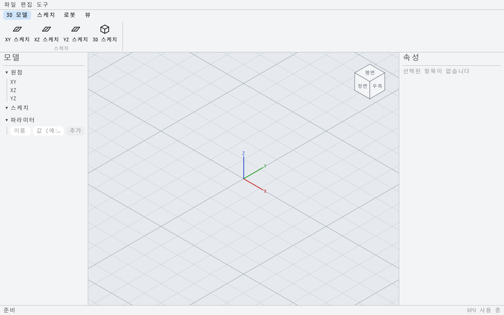
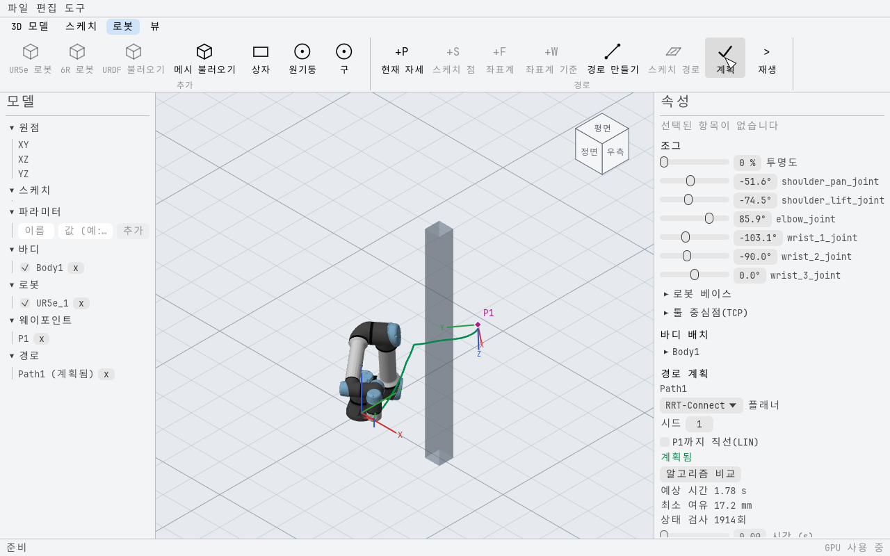
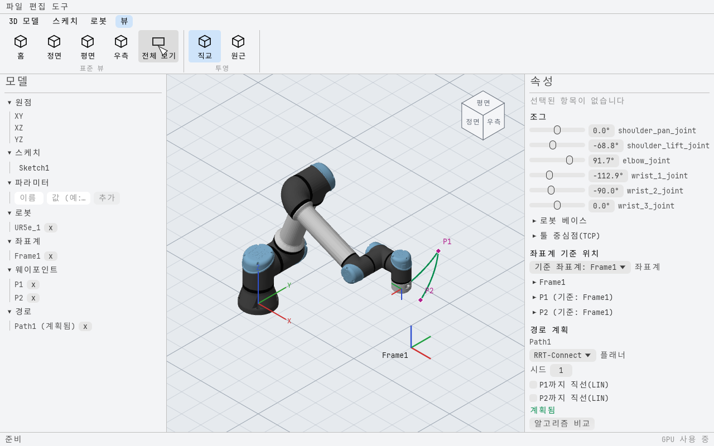
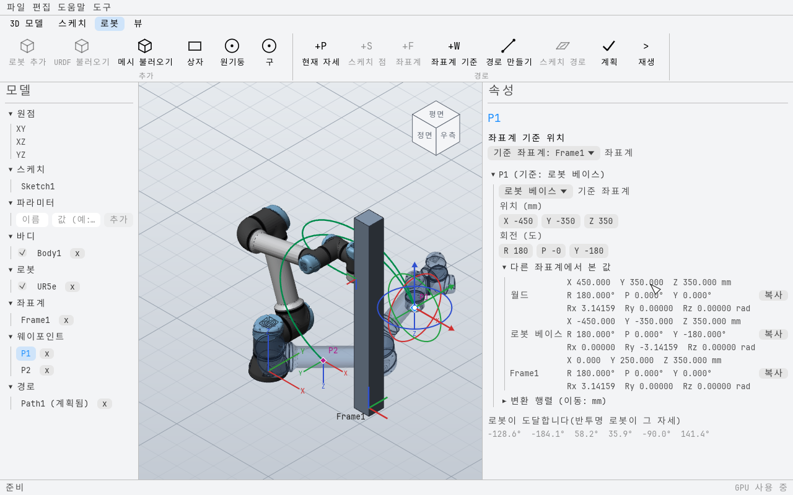
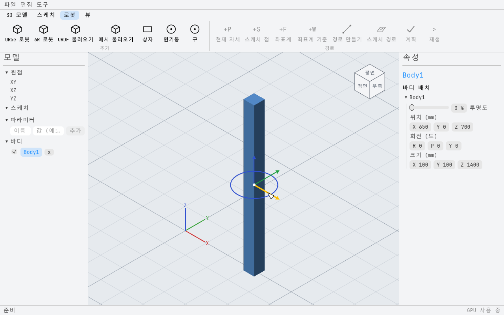
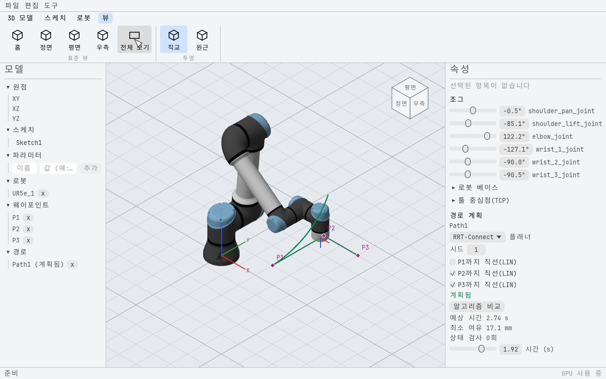
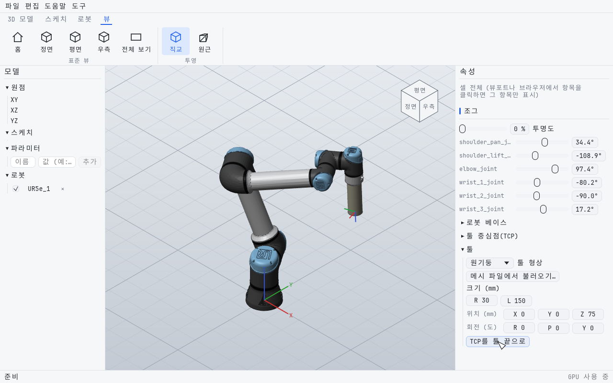
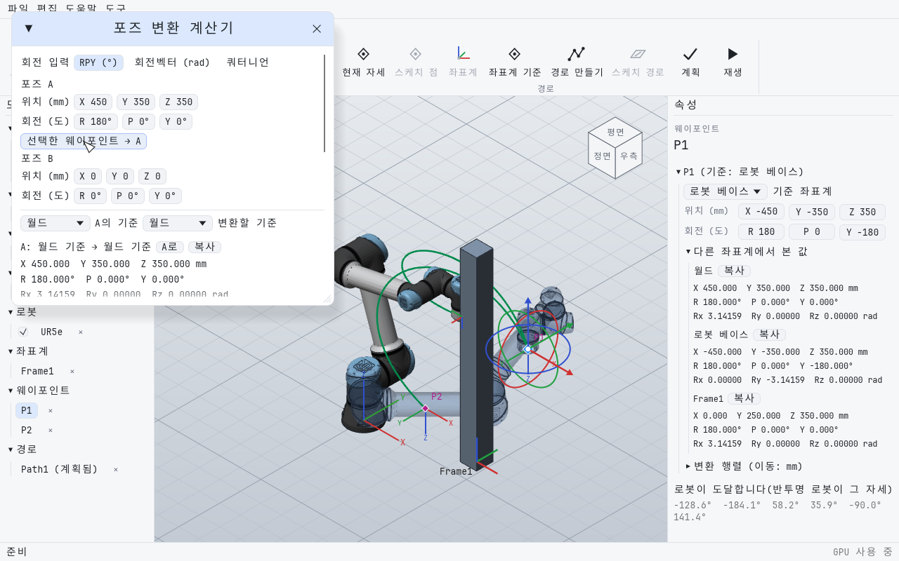

# GraphCTRL 사용자 가이드

로봇 셀(설비, 로봇, 웨이포인트, 경로)을 3D 작업공간에서 스케치하고 계획하는 방법을 순서대로 설명합니다.
화면 이름은 실제 프로그램의 한국어 표기를 그대로 씁니다. 기능 목록과 현재 상태는 [README](../../README.md)와
[진행 상태](../STATUS.md)를 보세요.

| 장 | 내용 |
|---|---|
| 1 | [설치와 실행](#1-설치와-실행) |
| 2 | [첫 실행: 예제 열기](#2-첫-실행-예제-열기) |
| 3 | [화면 구성](#3-화면-구성) |
| 4 | [스케치와 치수](#4-스케치와-치수) |
| 5 | [로봇 추가와 조그](#5-로봇-추가와-조그) |
| 6 | [작업 좌표계](#6-작업-좌표계) |
| 7 | [웨이포인트](#7-웨이포인트) |
| 8 | [경로 계획과 재생](#8-경로-계획과-재생) |
| 9 | [툴](#9-툴) |
| 10 | [포즈 변환 계산기](#10-포즈-변환-계산기) |
| 11 | [저장과 복구](#11-저장과-복구) |
| 12 | [조작 요약](#12-조작-요약) |
| 13 | [측정·간섭 분석·구동](#13-측정간섭-분석구동) |
| 14 | [AI 에이전트 연결 (MCP)](ai-agent.md) |

---

## 1. 설치와 실행

필요한 것은 [rustup](https://rustup.rs)입니다. Rust 버전은 저장소의 `rust-toolchain.toml`에 고정되어 있어 처음
실행할 때 자동으로 설치됩니다. Windows에서는 Visual Studio Build Tools(“C++를 사용한 데스크톱 개발”)가 필요합니다.

```bash
cargo run -p graphctrl
```

첫 빌드는 의존성 약 470개를 컴파일하므로 몇 분 걸립니다. 두 번째부터는 바뀐 부분만 다시 컴파일합니다.

**빌드 중 메모리 부족 오류**(`rustc-LLVM ERROR: out of memory`, `memory allocation of ... bytes failed`)가 나면
동시에 컴파일하는 크레이트 수를 줄이세요. 이미 끝난 크레이트는 다시 컴파일하지 않습니다.

```bash
cargo run -p graphctrl -j 2
```

매번 붙이기 번거로우면 PowerShell에서 환경 변수로 정해 둘 수 있습니다.

```powershell
$env:CARGO_BUILD_JOBS = "2"
```

숫자가 작을수록 메모리를 덜 쓰고 빌드는 느려집니다.

### 배포할 때: `robots` 폴더
로봇은 실행 파일 안에 들어 있지 않고 실행 파일 밖의 `robots` 폴더에 있습니다. 배포할 때는 실행 파일 옆에 `robots` 폴더를
함께 두세요. 프로그램은 실행 파일 옆, 작업 폴더, 그리고 작업 폴더의 위쪽 네 단계 안에서 `robots` 폴더를 찾습니다.
폴더를 넣거나 빼면 **로봇 추가** 목록이 바뀝니다. 목록은 프로그램을 시작할 때 읽으므로 바꾼 뒤에는 프로그램을 다시 시작하세요. 다시 빌드할 필요는 없습니다.

```text
GraphCTRL.exe
robots/
  ur3e/  ur5e/  ur10e/  ur16e/  sample-6r/
```

각 로봇 폴더(패키지)의 구조는 다음과 같습니다. 자세한 형식은 저장소의 [robots/README.md](../../robots/README.md)를 보세요.

- `robot.json`: 이름, 제조사, 설명 파일, 도달 거리, 가반 하중, 라이선스
- `<설명>.urdf`: 로봇 기술 파일. 메시는 `package://<패키지>/meshes/...`로 참조
- `meshes/visual/`: 화면에 그리는 메시, `meshes/collision/`: 충돌 검사용 메시
- `LICENSE`: 패키지 내용의 라이선스(도움말 > 라이선스에 표시)

프로젝트 파일은 라이브러리 로봇을 `library://<패키지>`로 기억합니다. 그래서 `robots` 폴더 위치가 PC마다 달라도
프로젝트가 열리고, 저장할 때 로봇 메시를 프로젝트 폴더로 복사하지 않습니다.

## 2. 첫 실행: 예제 열기

처음 써 본다면 **파일 > 예제 열기 (UR5e 셀)**를 누르세요. UR5e 로봇, 기둥 바디, 작업 좌표계(Frame1), 웨이포인트
P1·P2, 계획된 경로(Path1)가 들어 있어 기능을 한 번에 볼 수 있습니다.


예제의 값을 바꾸면 경로가 "오래됨"으로 표시됩니다. 그대로 두고 "계획"과 "재생"을 눌러 보세요.

## 3. 화면 구성



| 영역 | 위치 | 하는 일 |
|---|---|---|
| 리본 | 위쪽 | 탭별 명령. **3D 모델**(3D 스케치), **스케치**, **로봇**, **뷰** |
| 모델 브라우저 | 왼쪽 | 원점, 스케치, 파라미터, 바디, 로봇, 좌표계, 웨이포인트, 경로. 체크박스로 보이기/숨기기, `×`로 삭제 |
| 뷰포트 | 가운데 | 3D 작업공간. 오른쪽 위의 ViewCube를 눌러 표준 방향으로 봄 |
| 속성 | 오른쪽 | 선택한 항목의 값. 아무것도 선택하지 않으면 **셀 전체**(조그, 바디 배치, 경로 계획 등) |
| 상태바 | 아래 | 현재 안내 문구, 스케치 구속 상태, GPU 사용 여부 |

- 뷰포트에서 항목에 마우스를 올리면 주황색으로 강조되고, 클릭하면 파란색으로 선택됩니다. 브라우저 선택과 연동됩니다.


- 항목을 우클릭하면 숨기기/보이기, 삭제 등을 할 수 있습니다. Esc는 선택 해제, Delete는 삭제입니다.
- 뷰 조작(Inventor 방식): 휠 = 확대/축소, 가운데 버튼 드래그 = 이동, Shift + 가운데 버튼 드래그 또는 F4 + 왼쪽
  드래그 = 회전, F6 = 홈 화면.

## 4. 스케치와 치수

### 2D 스케치
1. **스케치** 탭에서 XY, XZ, YZ 중 평면을 고르고 스케치를 시작합니다.
2. **작성** 그룹의 선, 원, 호, 사각형 도구로 형상을 그립니다. 단축키는 L(선), C(원), A(호), R(사각형)입니다.
3. **구속** 그룹에서 일치, 수평, 수직, 평행, 직각, 접선 등 구속조건을 넣습니다.
4. **치수** 도구로 길이나 각도를 넣습니다. `25 mm`처럼 단위를 붙이고, `폭 * 2`처럼 수식이나 파라미터 이름을 쓸 수 있습니다.
   치수 값은 더블클릭해서 고칩니다.
5. 상태바에 "N개 치수 필요"가 나오다가 "완전 구속"이 되면 스케치의 위치가 모두 정해진 것입니다.
6. **스케치 마무리**로 나갑니다.

**과구속**: 이미 다른 구속으로 정해진 치수를 넣으면 "참조 치수로 넣을까요?"라고 묻습니다. 참조 치수는 값을 보여 주기만
하고 스케치를 움직이지 않습니다.

**파라미터**: 모델 브라우저의 **파라미터** 표에 `이름`과 `값`(예: `20 mm`)을 넣고 **추가**하면 치수 수식에서 그 이름을
쓸 수 있습니다. 이름을 바꾸면 그 파라미터를 쓰는 치수가 함께 바뀝니다.


### 3D 스케치
로봇 경로를 공간에 그릴 때 씁니다.
1. **3D 모델** 탭 > **3D 스케치**를 누릅니다.
2. 선 도구로 점을 찍어 폴리라인을 만듭니다.
   - 기존 점에 붙일 수 있습니다.
   - 직전 점을 지나는 X, Y, Z 축에 자동으로 잠깁니다.
   - 그 밖에는 **작업 평면** 위에 놓입니다. Tab을 누르면 XY, YZ, ZX 평면이 번갈아 바뀝니다. 상태바에 현재 평면이 표시됩니다.
3. 길이, 높이 치수와 X/Y/Z 방향, 평면 위 구속을 넣을 수 있습니다.


## 5. 로봇 추가와 조그

### 로봇 추가
**로봇** 탭 > **추가** 그룹 > **로봇 추가**에서 `robots` 폴더에 있는 로봇 중 하나를 고릅니다. 기본 패키지는
**UR3e, UR5e, UR10e, UR16e, 6R 로봇**입니다. UR 로봇은 공식 사양에서 만든 모델이며 해석적 역기구학(IK)을 씁니다.
6R 로봇(`sample-6r`)은 기본 도형으로 만든 샘플 6축 팔입니다.

목록에 원하는 로봇이 없으면 같은 형식의 패키지 폴더를 `robots`에 넣고 프로그램을 다시 시작하세요. 사용하지 않는 로봇은
폴더째 빼고 다시 시작하면 목록에서 사라집니다.


다른 로봇은 **URDF 불러오기**로 `.urdf` 파일을 읽을 수 있습니다. 메시(STL, COLLADA)는 URDF 파일이 있는 폴더 주변에서
찾습니다. 찾지 못한 메시가 있으면 그 부분은 그려지지도, 충돌 검사에도 들어가지 않는다는 알림이 나옵니다.

### 로봇 베이스와 TCP
로봇을 선택하면 속성에 다음 항목이 나옵니다.
- **로봇 베이스**: 로봇이 놓인 위치(mm)와 회전(도).
- **툴 중심점(TCP)**: 플랜지에서 툴 끝까지의 오프셋. 툴을 달았다면 [9. 툴](#9-툴)에서 "TCP를 툴 끝으로"를 누르면
  툴 끝이 TCP가 됩니다.

### 조그
**조그** 슬라이더와 입력 칸으로 관절을 움직입니다. 자세가 충돌하면 해당 링크가 붉게 표시되고, 속성 패널에 충돌하는 두 부분이 나옵니다.
관절 한계를 넘으면 그 관절이 표시됩니다.

**투명도** 슬라이더(0~95 %)로 바디나 로봇을 비쳐 보이게 할 수 있습니다. 화면만 바뀌고, 숨기거나 투명한 설비도
경로 계획에서는 계속 장애물입니다.



### 바디(설비)
- **상자, 원기둥, 구**: 추가 그룹의 버튼으로 기본 도형을 넣고, 속성에서 위치(mm)·크기(mm)·회전(도)를 입력합니다.
- **메시 불러오기**: STL 파일을 바디로 넣습니다. 파일 단위가 mm이면 **배율**이 자동으로 m로 환산됩니다.
- 기즈모(아래 [7장](#7-웨이포인트))로 끌어서 옮길 수도 있습니다.

## 6. 작업 좌표계

설비 위의 기준점(예: 파지 위치, 작업대 모서리)을 원점으로 하는 좌표계를 만듭니다. 로봇 컨트롤러의 3점 사용자 좌표계와
같은 방식입니다.

1. 스케치에서 점을 하나 만들고 치수나 **고정** 구속으로 **완전히 구속**합니다. 구속되지 않은 점은 좌표계의 원점이 될 수 없습니다.
2. 그 점을 선택하고 **로봇** 탭 > **좌표계**를 누릅니다. 점 하나면 스케치 축을 씁니다.
3. 방향까지 정하려면 점을 **Ctrl + 클릭**으로 차례대로 2~3개 고릅니다.
   - 1번 점: 원점
   - 2번 점: X축이 향하는 점
   - 3번 점: XY 평면 위의 점(+Y 쪽)
   - 점이 2개면 Z는 스케치 법선입니다.
4. 속성 패널에서 축 점을 바꾸거나 R/P/Y로 더 돌릴 수 있습니다.
5. 좌표계의 6축 값(X, Y, Z, R, P, Y와 UR 회전 벡터)이 **월드 기준**과 **로봇 베이스 기준**으로 표시됩니다.



원점 치수를 바꾸면 그 좌표계를 기준으로 한 웨이포인트와 경로가 함께 움직입니다(경로는 "오래됨"이 됩니다).

## 7. 웨이포인트

웨이포인트는 로봇이 거쳐 갈 자세입니다. 만드는 방법은 세 가지입니다.

| 버튼 | 만들어지는 것 |
|---|---|
| **현재 자세** | 지금 로봇 자세를 그대로 저장 |
| **스케치 점** | 스케치에서 고른 점을 따라다니는 웨이포인트. 스케치를 고치면 따라 움직임 |
| **좌표계 기준** | 로봇의 현재 TCP 자세를 선택한 좌표계 기준으로 저장 |

### 기준 좌표계
웨이포인트의 위치와 자세는 **기준 좌표계**(월드, 로봇 베이스(UR 티치펜던트의 Base), 작업 좌표계 중 하나)에서 표시됩니다.
기준을 바꿔도 로봇이 가는 자세는 그대로이고, 표시되는 값만 바뀝니다.

속성의 **다른 좌표계에서 본 값**을 펼치면 같은 자세를 다른 기준으로 본 숫자와 변환 행렬을 볼 수 있습니다.



### 기즈모로 옮기기
선택한 바디, 로봇, 좌표계 기준 웨이포인트에는 기즈모가 나타납니다.
- **X/Y/Z 화살표**를 끌면 그 축으로 움직입니다. 1 mm 단위, Shift를 누르면 10 mm, Ctrl을 누르면 자유롭게 움직입니다.
- **빨강/초록/파랑 링**을 끌면 X/Y/Z축으로 회전합니다. 1° 단위, Shift를 누르면 15°, Ctrl을 누르면 자유롭게 돌립니다.
- 끄는 동안 이동량이 옆에 표시되고, 놓으면 실행 취소 한 단계로 기록됩니다.
- 좌표계는 원점이 구속된 점이라 회전 링만 나옵니다.

### 고스트 로봇
웨이포인트나 경로의 점을 선택하거나 가리키면 그 자세의 로봇이 **반투명**하게 나타납니다. 도달할 수 없거나 문제가 있으면
붉게 표시되고, 속성 창에 도달 여부와 관절값이 나옵니다.


선택한 항목에는 기즈모가 나옵니다.



### 웨이포인트 순서
**경로** 항목에서 웨이포인트를 **↑ ↓**로 옮기거나, **빼기**로 경로에서 빼고, **웨이포인트 추가**로 다시 넣습니다.
순서 편집도 실행 취소 한 단계로 되돌릴 수 있습니다.

## 8. 경로 계획과 재생

1. 웨이포인트를 여러 개 고른 뒤 **로봇** 탭 > **경로 만들기**를 누릅니다.
   - 스케치에 그려 둔 선이 있다면 **스케치 경로**를 누릅니다. 선의 끝점이 웨이포인트가 되고, 각 선은 직선 이동이 됩니다.
2. 경로를 선택하면 **경로 계획** 섹션이 나옵니다.
   - 웨이포인트마다 **자유 이동**과 **직선 이동(LIN)** 중 하나를 고릅니다. 직선 이동은 툴 끝이 직선으로 움직입니다.
   - **직선 이동 TCP 속도 제한**을 켜면 직선 구간의 툴 속도가 상한을 넘지 않도록 궤적을 고르게 늦춥니다.
   - **플래너**: RRT-Connect(기본), RRT, RRT*, Informed RRT*, PRM 중 고릅니다. 시드를 바꾸면 결과가 달라집니다.
3. **계획**을 누릅니다. 계획은 작업 스레드에서 돌고, **취소**할 수 있습니다.
4. 결과 카드에 예상 시간, 최소 여유(장애물까지 거리), 상태 검사 횟수, 최대 TCP 속도가 나옵니다.
5. **재생**으로 움직임을 봅니다. **정지**로 멈춥니다. 시간(s) 값으로 특정 시점을 볼 수 있습니다.

**오래됨**: 장애물, 스케치, 웨이포인트, 좌표계 등을 고치면 경로에 "오래됨(다시 계획 필요)"이 붙습니다. 그 상태로
재생하면 이전 계획이 보이므로 다시 계획하세요.

**알고리즘 비교**: 경로 계획 섹션의 **알고리즘 비교**는 모든 플래너를 같은 경로에 돌려 성공률, 예상 시간, 검사 수를 표로
보여 줍니다. 표 위에 "이전 상태 기준 결과"가 나오면 셀을 고친 뒤 다시 실행하세요.




## 9. 툴

로봇의 **툴** 섹션에서 툴 끝에 붙는 형상을 정합니다.

- **툴 형상**: 없음, 원기둥, 상자, 구, 메시 파일 중 하나. **메시 파일에서 불러오기…**로 STL을 읽습니다.
- **크기**와 **위치, 회전**으로 플랜지 기준 위치를 맞춥니다.
- 툴은 로봇 링크의 일부로 충돌 검사와 경로 계획에 들어갑니다.
- **TCP를 툴 끝으로**를 누르면 TCP가 툴 끝으로 옮겨집니다.



## 10. 포즈 변환 계산기

**도구 > 포즈 변환 계산기**에서 위치와 자세를 계산합니다.

- **회전 입력**: RPY(도), 회전벡터(rad), 쿼터니언 중 고릅니다. UR 컨트롤러가 쓰는 형식은 회전벡터입니다.
- **포즈 A, 포즈 B**: 위치와 회전을 입력합니다. **선택한 웨이포인트 → A**로 웨이포인트 값을 가져올 수 있습니다.
- **A의 기준**과 **변환할 기준**을 고르면 A를 다른 기준에서 본 값을 보여 줍니다.
- **A · B**(합성), **A^-1**(역변환), **A^-1 · B**(A에서 본 B)를 계산합니다. **복사**로 결과를 옮길 수 있습니다.



## 11. 저장과 복구

- **파일 > 저장**(Ctrl+S), **다른 이름으로 저장**(Ctrl+Shift+S), **열기**(Ctrl+O), **새로 만들기**(Ctrl+N).
- 프로젝트는 `이름.gctrl` 파일입니다. 불러온 메시와 URDF 로봇의 메시 파일은 옆의 `이름_files` 폴더에 복사됩니다.
  `.gctrl` 파일과 `_files` 폴더를 **함께** 옮기면 다른 PC에서도 열립니다.
- **파일 > 최근 프로젝트**에 최근 8개가 남습니다.
- 저장하지 않은 작업은 1분마다 자동 저장됩니다. 프로그램이 비정상 종료되면 다음 실행 때 복구할지 묻습니다.
  자동 저장 파일은 Windows에서 `%APPDATA%\GraphCTRL`, Linux에서 `~/.config/graphctrl`에 있습니다. 복구한 작업은
  저장해야 남습니다.
- **도움말 > 정보**에서 버전과 설정·복구 폴더를 확인할 수 있습니다.
- **편집 > 실행 취소**(Ctrl+Z)와 **다시 실행**(Ctrl+Y)으로 편집을 되돌리거나 다시 합니다. 기즈모 이동과 웨이포인트 순서 편집도 한 단계씩 되돌릴 수 있습니다.

## 12. 조작 요약

| 입력 | 동작 |
|---|---|
| 휠 | 확대/축소 |
| 가운데 드래그 | 이동 |
| Shift + 가운데 드래그, F4 + 왼쪽 드래그 | 회전 |
| F6 | 홈 화면 |
| L, C, A, R | 스케치 도구: 선, 원, 호, 사각형 |
| Tab | 3D 스케치 작업 평면 전환(XY → YZ → ZX) |
| Ctrl + 클릭 | 좌표계 점을 순서대로 여러 개 고르기 |
| Esc | 도구 취소, 선택 해제 |
| Delete | 선택 항목 삭제 |
| Ctrl+Z / Ctrl+Y | 실행 취소 / 다시 실행 |
| Ctrl+N / Ctrl+O / Ctrl+S | 새로 만들기 / 열기 / 저장 |

## 13. 측정·간섭 분석·구동

세 기능은 모두 **도구** 메뉴에 있습니다. 측정과 간섭 분석은 창을 연 채로 뷰포트와 브라우저에서 항목을 고르고, 구동은
로봇 관절을 정해진 순서로 움직여 봅니다. 현재 구현 범위와 Inventor와의 차이는
[어셈블리 환경 동등성 명세 §3.6.1](../ux/inventor-assembly-parity.md)에 있습니다.

### 측정 (도구 > 측정)
1. **도구 > 측정**을 엽니다. 창에 "선택 1"과 "선택 2"가 나타납니다.
2. 뷰포트나 브라우저에서 항목을 고릅니다. 첫 번째는 선택 1, 두 번째는 선택 2에 들어갑니다. 빈 곳을 클릭하면 다시 시작합니다.
3. 선택 우선순위를 고릅니다.
   - **컴포넌트 우선**: 바디, 로봇, 웨이포인트, 좌표계 단위로 고릅니다. 두 개를 고르면 **최소 거리**가 나옵니다.
   - **모서리 및 면 우선**: 메시의 모서리와 면, 꼭짓점을 고릅니다. 모서리 길이, 면 면적, 점 위치가 나옵니다.
4. 두 항목을 고르면 거리와 좌표 차이(Δ X, Y, Z), Z축 사이 각도가 나옵니다. 거리는 **최소 거리**와 **중심 간 거리**를 바꿔 볼 수 있습니다.
5. 값을 누르면 복사할 수 있고, **모두 복사**로 한꺼번에 복사할 수 있습니다. **완료**를 누르면 창을 닫습니다.

> 최대 거리와 기준 UCS 선택은 아직 없습니다. 좌표를 다른 좌표계 기준으로 보려면 웨이포인트의 "다른 좌표계에서 본 값"을 쓰세요(7장).

### 간섭 분석 (도구 > 간섭 분석)
1. **도구 > 간섭 분석**을 엽니다.
2. **세트 #1 정의**를 누른 뒤 컴포넌트를 고릅니다. 다시 고르면 빠집니다. **세트 #2 정의**도 같은 방식입니다.
   - 세트 #2가 비어 있으면 **세트 #1 안에서 서로** 검사합니다.
   - **모든 컴포넌트를 세트 #1에**를 누르면 로봇과 바디 전부가 들어갑니다.
3. 분석 결과에 간섭 개수, 총 체적, 항목마다 체적과 중심 좌표(mm)가 나옵니다.
4. 항목을 **두 번 클릭**하면 그 간섭 영역으로 확대됩니다. 뷰포트에는 간섭 영역이 빨간 점으로 표시됩니다.
5. **무시**로 확인이 끝난 간섭을 뺄 수 있습니다. **이 체적 이하 모두 무시**로 작은 간섭을 한꺼번에 뺄 수 있고, **무시 해제**로 되돌립니다. "무시한 항목 표시"를 켜면 무시한 항목이 취소선과 함께 보입니다.
6. **다시 분석**으로 세트를 고쳐 다시 검사합니다.

> 체적은 충돌 형상 위의 격자 표본으로 **추정**한 값입니다. 나사 같은 항목을 거르는 필터는 아직 없습니다.

### 구동 (도구 > 구동)
1. **도구 > 구동**을 엽니다. 로봇과 관절을 고릅니다.
2. **시작**은 지금 관절값, **끝**은 시작 + 10으로 정해집니다. **일시 중지 지연(초)**으로 한 단계 사이의 시간을 정합니다.
3. **자세히**를 펼치면 다음을 정할 수 있습니다.
   - **충돌 감지**: 체크하면 충돌하는 순간 멈추고 원인을 표시합니다.
   - **증분**: 값의 양(예: 5°씩) 또는 총 단계 수.
   - **반복**: **시작/끝**(한 번 가고 시작으로 돌아옴) 또는 **시작/끝/시작**(가고 오기), 그리고 반복 횟수.
4. **정방향**, **역방향**, **중지**, **한 단계 앞으로/뒤로**, **시작으로**, **끝으로**로 움직입니다.
5. 충돌하면 멈추고 충돌 쌍이 표시됩니다.
6. 구동 창을 닫으면 로봇은 **원래 자세로 돌아갑니다**. 구동은 셀 문서를 바꾸지 않습니다.

> 한 번에 관절 하나만 구동합니다. 여러 관절을 연결하는 방정식과 구동 중 자동 조정(적응성), 동작 기록(동영상)은 아직 없습니다.

문제가 있으면 [알려진 문제](../KNOWN_ISSUES.md)를 먼저 보세요.
